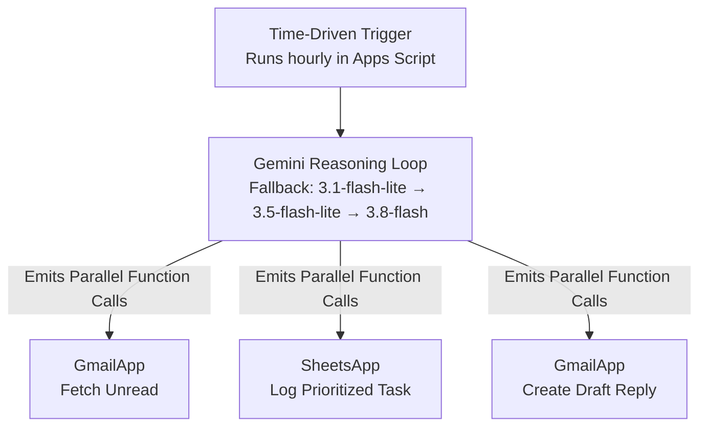

# Autonomous Workspace Triage Agent

An autonomous, multi-step AI agent built with **Gemini API (Function Calling)** and **Google Apps Script** that perceives unread inbox context, filters noise, logs prioritized action items to Google Sheets, and drafts context-aware email replies—running completely serverless on Google's free tier.

---

## Architecture & Execution Flow

Unlike a standard single-turn chatbot, this system implements a **ReAct (Reason + Act)** execution loop with multi-turn state management, parallel tool execution, and automatic model fallback routing.



### Core Engineering Features

* **Multi-Turn ReAct Loop:** Maintains conversation state across tool observations, allowing the LLM to inspect unread emails, decide which require action, execute multiple tools in parallel, and generate a structured execution report.
* **Resilient Multi-Model Fallback Routing:** Automatically handles transient `503 Service Unavailable` and `429 Rate Limit` errors by cascading across Gemini Flash endpoints (`gemini-3.1-flash-lite` → `gemini-3.5-flash-lite` → `gemini-3.8-flash`) with graceful error handling (`muteHttpExceptions: true`).
* **Parallel Tool Execution:** Processes multiple `functionCall` parts emitted in a single model turn and bundles tool outputs into a unified `functionResponse` payload, keeping total execution time under 30 seconds (well within Apps Script's 6-minute runtime limit).
* **Human-in-the-Loop (HITL) Safety Guardrails:** Restricts outbound email actions strictly to Gmail **Drafts** rather than auto-sending, and prevents replies to `noreply` / `donotreply` addresses.
* **Zero-Infrastructure OAuth:** Container-bound to Google Sheets via Google Apps Script, eliminating external servers, Docker containers, or manual OAuth token refresh pipelines.

---

## Tech Stack

* **LLM & Tool Use:** Gemini API (`generateContent` REST endpoint with Function Calling)
* **Runtime & Orchestration:** Google Apps Script (V8 Runtime)
* **Integrations:** Native Google Workspace Services (`GmailApp`, `SpreadsheetApp`, `PropertiesService`, `UrlFetchApp`)
* **Version Control:** `@google/clasp` (Command Line Apps Script Projects)

---

## Project Structure

```text
├── Code.gs              # Agent ReAct loop, tool declarations, Workspace handlers, & fallback router
├── appsscript.json      # Apps Script manifest & OAuth scopes
└── README.md            # Documentation & setup guide
```

---

## Setup & Deployment

### 1. Prerequisites

* A Google Account with Gmail and Google Sheets enabled.
* A free API key from [Google AI Studio](https://aistudio.google.com/).

### 2. Google Workspace Configuration

1. Create a new Google Sheet named `AI_Agent_Workspace`.
2. Add the following column headers in Row 1:
   ```text
   Timestamp | Sender | Summary | Priority
   ```
3. Open **Extensions → Apps Script** from the top menu.
4. Paste the contents of `Code.gs` into the script editor and save (`Ctrl + S`).

### 3. Configure Secrets

1. In the Apps Script editor, navigate to **Project Settings** (gear icon) → **Script Properties**.
2. Click **Add script property**:
   * **Property:** `gem_key`
   * **Value:** `<YOUR_GOOGLE_AI_STUDIO_API_KEY>`

### 4. Authorize & Automate

1. Select `runWorkspaceAgent` in the toolbar dropdown and click **Run**.
2. Complete the Google OAuth consent screen (**Advanced → Go to Project → Allow**).
3. To run autonomously in the background: go to **Triggers** (alarm clock icon) → **+ Add Trigger** → configure `runWorkspaceAgent` as a **Time-driven** hourly trigger.

---

## Local Development with `clasp`

To sync changes between your local machine and Google Apps Script:

```bash
# Install Google's Apps Script CLI
npm install -g @google/clasp

# Authenticate with your Google account
clasp login

# Clone your container-bound script
clasp clone <YOUR_SCRIPT_ID>

# Push local updates to Apps Script
clasp push
```

---

## Sample Execution Log

```text
19:40:39  Notice  Execution started
19:40:47  Info    Success using model: gemini-3.5-flash-lite
19:40:47  Info    Step 1 -> Executing tool: fetchUnreadEmails
19:40:53  Info    Success using model: gemini-3.5-flash-lite
19:40:53  Info    Step 2 -> Executing tool: logTaskToSheet
19:40:54  Info    Step 2 -> Executing tool: createDraftReply
19:41:04  Info    Agent Final Report:
                  - Ignored automated security alerts & newsletters.
                  - Logged actionable internship inquiry (Priority: Medium) to Google Sheets.
                  - Generated draft response in Gmail for human review.
19:41:05  Notice  Execution completed
```

---

## Future Roadmap

* **Google Doc RAG Integration:** Dynamically inject personal context (resume, availability, project FAQs) from a Google Doc via `DocumentApp.openById()` into the system prompt for hyper-personalized draft replies.
* **Structured Output Enforcement:** Enforce strict `responseSchema` definitions on extraction tools to guarantee deterministic formatting.
* **Webhook Digest Notifications:** Send an interactive summary card to Google Chat or Slack whenever high-priority tasks are logged.
